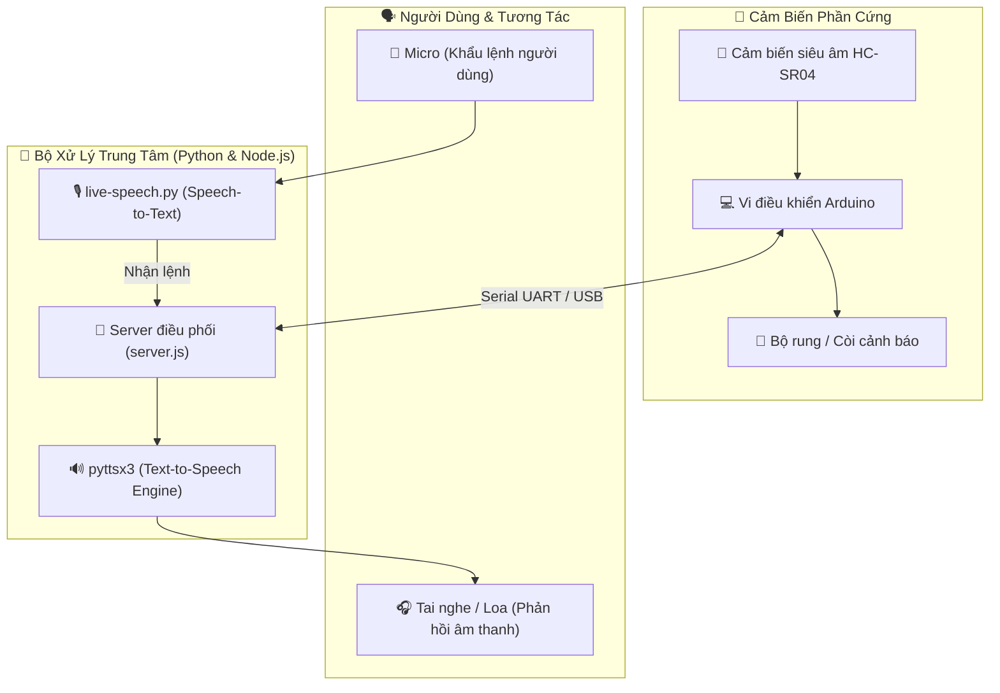

<div align="center">

# 👁️ DEVICE FOR BLIND PEOPLE 👁️
### 🦯 Intelligent Assistive Wearable System for the Visually Impaired
*Thiết Bị Trợ Lý Đeo Tay Thông Minh Hỗ Trợ Người Khiếm Thị Tương Tác Giọng Nói & Cảnh Báo Vật Cản*

[](https://python.org)
[](https://www.arduino.cc/)
[](https://pypi.org/project/SpeechRecognition/)
[](https://nodejs.org/)

---

</div>

> [!IMPORTANT]
> **Device for Blind People** là dự án công nghệ trợ năng tích hợp cảm biến siêu âm phát hiện chướng ngại vật cùng hệ thống phản hồi âm thanh hai chiều (Nhận diện giọng nói STT & Chuyển văn bản thành giọng nói TTS), mang lại sự an toàn và độc lập cho người khiếm thị khi di chuyển.

---

## 📑 Mục Lục (Table of Contents)
- [✨ Tính Năng Nổi Bật](#-tính-năng-nổi-bật)
- [🏗️ Kiến Trúc Hệ Thống](#️-kiến-trúc-hệ-thống)
- [📂 Cấu Trúc Dự Án](#-cấu-trúc-dự-án)
- [⚙️ Công Nghệ Sử Dụng](#️-công-nghệ-sử-dụng)
- [🚀 Hướng Dẫn Cài Đặt & Chạy Dự Án](#-hướng-dẫn-cài-đặt--chạy-dự-án)
- [🔮 Lộ Trình Phát Triển (Roadmap)](#-lộ-trình-phát-triển-roadmap)
- [📜 Giấy Phép (License)](#-giấy-phép-license)

---

## ✨ Tính Năng Nổi Bật

| Biểu Tượng | Tính Năng | Mô Tả Chi Tiết |
| :---: | :--- | :--- |
| 🔊 | **Giao Tiếp Giọng Nói Thời Gian Thực** | Lắng nghe câu lệnh của người dùng qua micro và phản hồi hướng dẫn chỉ đường / tình trạng môi trường bằng giọng nói tự nhiên. |
| 📡 | **Đo Đạc Khoảng Cách & Cảnh Báo** | Cảm biến siêu âm gắn trên thiết bị liên tục quét vật cản và cảnh báo bằng rung hoặc chuông buzzer theo mức độ nguy hiểm. |
| 🖥️ | **Bảng Điều Khiển Web Giám Sát** | Người thân hoặc người hỗ trợ có thể theo dõi trạng thái thiết bị và dữ liệu khoảng cách qua giao diện Web cục bộ. |
| 🧪 | **Bộ Kịch Bản Kiểm Thử Độc Lập** | Có sẵn các script kiểm tra độ trễ (`test-delay.py`), kiểm tra khởi tạo (`test-initlaize.py`) và test giao tiếp server. |

---

## 🏗️ Kiến Trúc Hệ Thống



---

## 📂 Cấu Trúc Dự Án

```bash
device-for-blind-people/
├── 📄 live-speech.py          # Module lắng nghe giọng nói trực tiếp và nhận diện khẩu lệnh
├── 📄 index.py                # Điểm khởi chạy xử lý logic thiết bị
├── 📄 server.js               # Máy chủ Node.js quản lý kết nối và cung cấp API Web
├── 📄 index.html              # Trang giao diện theo dõi hoạt động thiết bị
├── 📂 arduino-program/        # Chương trình C/C++ nạp vào bo mạch vi điều khiển Arduino
├── 📄 test-delay.py           # Kịch bản kiểm tra độ trễ phản hồi của hệ thống
├── 📄 test-control.py         # Kịch bản kiểm tra các tín hiệu điều khiển phần cứng
├── 📄 test-initlaize.py       # Kịch bản kiểm thử khởi động các linh kiện
├── 📄 package.json            # Thư viện phụ thuộc Node.js
└── 📄 README.md               # Tài liệu hướng dẫn dự án
```

---

## ⚙️ Công Nghệ Sử Dụng

- **Voice Processing**: Python, `speech_recognition`, `pyttsx3`, `pyaudio`
- **Embedded Hardware**: Arduino Uno / Nano, HC-SR04 Ultrasonic Sensor, Vibration Motor
- **Server & Web**: Node.js, Express, PySerial, HTML5/CSS

---

## 🚀 Hướng Dẫn Cài Đặt & Chạy Dự Án

```bash
# 1. Clone repository
git clone https://github.com/baolam/device-for-blind-people.git
cd device-for-blind-people

# 2. Cài đặt thư viện Python
pip install speechrecognition pyaudio pyttsx3 pyserial requests

# 3. Cài đặt các gói Node.js
npm install

# 4. Nạp code Arduino
# Mở thư mục arduino-program/ bằng Arduino IDE và bấm Upload lên vi điều khiển

# 5. Chạy hệ thống
python live-speech.py
node server.js
```

---

## 🔮 Lộ Trình Phát Triển (Roadmap)

- [ ] 👓 **Smart Glasses Form Factor**: Tích hợp phần cứng gọn gàng lên gọng kính bảo hộ.
- [ ] 🤖 **OCR Money & Text Reader**: Tích hợp camera nhận diện mệnh giá tiền mặt và đọc biển hiệu đường phố.

---

<div align="center">

## 📜 Giấy Phép (License)

Dự án được phân phối dưới giấy phép **MIT License**.

---
**Made with ❤️ by [Bảo Lâm](https://github.com/baolam)**

</div>
